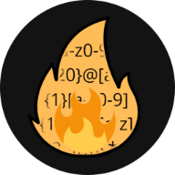
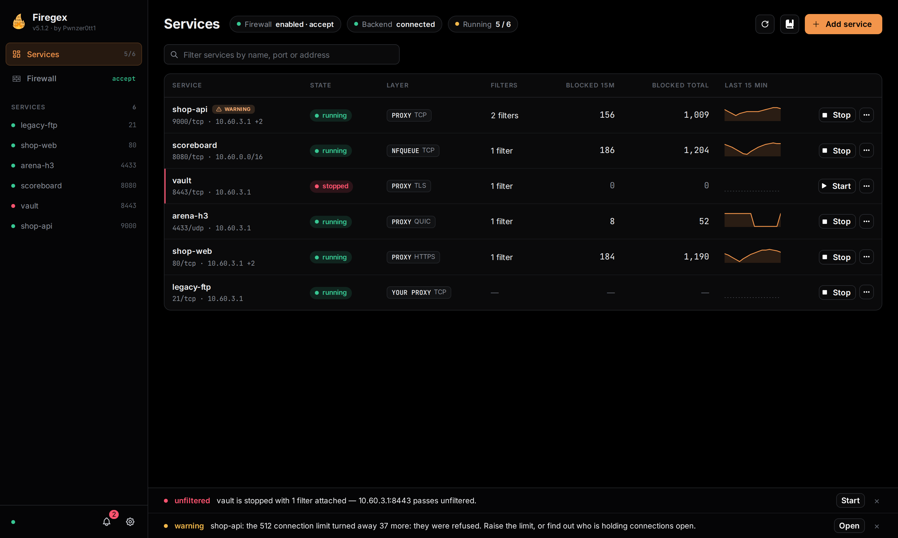
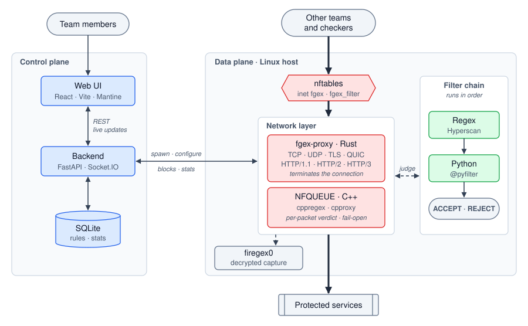

<h1><br />[Fi]*regex 🔥</h1>

<a href="https://github.com/Pwnzer0tt1/firegex/releases/latest"></a>   

You can see a demo [here](https://demo.firegex.pwnzer0tt1.it/)

<br clear="left" />

A firewall for CTF Attack-Defense competitions: it sits in front of your vulnerable services
and blocks malicious traffic before it reaches them.

## Quick start

You need a Linux machine. Docker is recommended; without it (or rootless), firegex runs
standalone in a chroot.

```bash
sh <(curl -sLf https://pwnzer0tt1.it/firegex.sh)
```

Or from a clone:

```bash
python3 run.py start --prebuilt     # prebuilt image (omit --prebuilt to build from source)
python3 run.py start --standalone   # force standalone mode
python3 run.py status
python3 run.py stop
```

The interface is on port **4444**; you choose a password on first start. Docker mode comes
back by itself after a reboot, standalone needs `start` again. Flags you pass are
remembered for later starts — see `python3 run.py start -h`.

```bash
python3 run.py config --show                 # current settings
python3 run.py config --port 8080            # applies on next start
python3 run.py config --password             # reset a lost password on the running instance
```



## What it does

- **[Services](docs/services.md)** — protect one or more addresses (IPs or interfaces) with
  an ordered chain of filters:
  - **Regex** filters matched by [hyperscan](https://github.com/VectorCamp/vectorscan),
    with a built-in tester that runs the real engine.
  - **Python** filters written against the [`firegex`](https://pypi.org/project/firegex/)
    library, with parsed HTTP, streams and gRPC messages — [guide](docs/pyfilter.md).
  - Two inspecting network layers: **NFQUEUE** (per packet, kernel fail-open) and a
    **proxy** (per connection, faster, terminates TLS/QUIC) — plus handing traffic to
    **your own proxy**. Both keep the client's IP.
  - TCP, UDP, **TLS**, **QUIC**, and **HTTP/1.1, HTTP/2 and HTTP/3** all shown to filters as
    HTTP/1.1, so one filter covers every version.
  - Per-rule block charts, a live log, and edits that apply without dropping connections.
- **[Firewall Rules](docs/firewall.md)** — plain nftables allow/drop/reject rules from the
  interface.

The same docs are shown inside the app via the docs button on each page.

## Access control

- `--allowed-ips` restricts the interface to CIDR ranges (with `--proxy-ip-header` behind
  a reverse proxy, which must overwrite that header).
- `--unsafe-disable-auth` hands access control to a reverse proxy: **every request that
  reaches firegex is an administrator**, so bind it to loopback or a socket.

  ```bash
  python3 run.py start --host 127.0.0.1 --unsafe-disable-auth
  ```

  The setting is persisted; `--no-unsafe-disable-auth` (or `run.py config --password`)
  turns authentication back on. It can also be toggled from the interface (*Firewall Access*
  menu) until the next restart; only the browser that turned it off can turn it back on.
  Password endpoints answer `403` while it is off.

## Project layout

- [Frontend (React)](frontend/README.md)
- [Backend (FastAPI + C++ and Rust datapaths)](backend/README.md)
- [Python filter library (`firegex` on PyPI)](fgex-lib/README.md)



Firegex is built to **never be the reason a service is down**: filters fail open, and any
change can be undone instantly.

## Credits

The web interface layout (sidebar, problem strip and services table) is inspired by [Icegex](https://github.com/ECSC-Team-Poland/icegex) by ECSC Team Poland.

The original design of Python filters is described in the [@domysh](https://domy.sh) [engineering thesis](https://github.com/domysh/engineering-thesis) (Italian); the current implementation has since evolved.

Copyright (c) 2022-2026 Pwnzer0tt1
