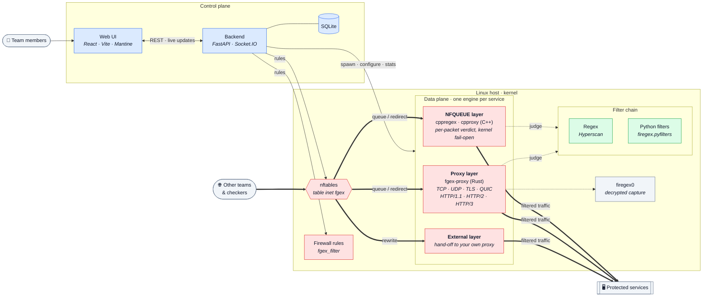

# Firegex backend

## [GO BACK](../README.md)

The backend of firegex is written with fastapi. The aim of the backend is to manage all the requests from the react front-end and manage also the proxy processes of the entire firewall. The fastapi webserver is responsable of deploying the react app.

Schematic example about how firegex manage the filters

### Read the documentation of the API going at `/api/docs` path and see the swagger documentation of the API.

## [GO BACK](../README.md)
